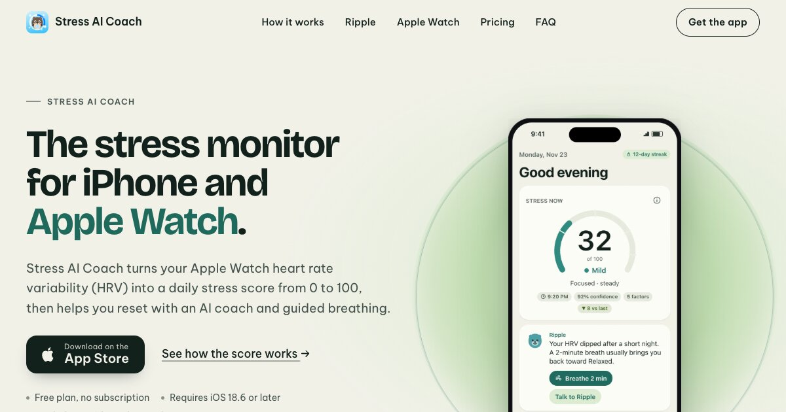

<p align="center">
  
</p>

The landing page, help, user guide and legal pages for [Stress AI Coach](https://apps.apple.com/app/id6778478266), an iPhone and Apple Watch app with the AI coach Ripple.

- Site: https://phuongddx.github.io/stress-coach-ai/
- App Store: https://apps.apple.com/app/id6778478266
- Also in Vietnamese: https://phuongddx.github.io/stress-coach-ai/vi/

## What's on the site

The site is built with [VitePress](https://vitepress.dev/). Every page has an English version and a Vietnamese version under `vi/`.

| Path on the site | Source |
|---|---|
| `/` | Landing page, `.vitepress/home/index.html` |
| `/get-started/` | One-minute check-in that ends in a starter plan and the App Store button, `.vitepress/home/get-started.html`. The same file serves `/vi/get-started/` |
| `/principle/` | `principle/`: how the stress score works (HRV, resting heart rate, stress levels, FAQ) |
| `/user-guide/` | `user-guide/`: measurement frequency, manual readings, notification problems |
| `/watch-widget/` | `watch-widget/`: watch faces, complications, widgets |
| `/legal/privacy`, `/legal/terms` | `legal/` |
| `/vi/...` | `vi/`, plus `.vitepress/home/vi.html` for the Vietnamese landing page |

## Run locally

You need Node 20, the version the workflows use.

```sh
npm ci
npm run dev                       # docs pages with hot reload
npm run build && npm run preview  # the full site, landing pages included
```

`npm run dev` does not show the landing page. At `/` it shows the VitePress home from `index.md`, which the build replaces. `scripts/home.mjs` copies the standalone landing pages over `dist/index.html` and `dist/vi/index.html` after `vitepress build`, so you only see them with `build` and `preview`.

The site's base is `/stress-coach-ai/`, so local URLs look like `http://localhost:4173/stress-coach-ai/`.

## Project layout

```text
.vitepress/
  config.ts         site config: base, locales, nav and sidebars (EN and VI)
  home/             standalone landing pages: index.html (EN), vi.html (VI),
                    get-started.html (check-in, EN and VI in one file)
  theme/            theme overrides; full page loads for the two landing pages
principle/          docs pages, one folder per section
user-guide/
watch-widget/
legal/
vi/                 Vietnamese copies of all of the above
public/
  img/              app screenshots (img/v2) and Ripple artwork (img/ripple)
  video/            the landing hero recording (mp4, webm, poster)
  share.jpg         1200x630 social preview image
scripts/home.mjs    copies the landing pages and get-started into the build output
.github/workflows/  deploy.yml (Pages) and pr-build.yml (PR check)
public/assets/, .taste-skill/, docs/screenshots/
                    tools and checks used to build the landing page, not site content
```

`vercel.json` is left over from an earlier host. The site is not deployed to Vercel.

## Editing content

- **Docs page.** Edit or add a `.md` file. If it is new, add it to the sidebar in `.vitepress/config.ts`. The English and Vietnamese sidebars are separate lists.
- **Both languages.** When you change an English page, change the matching page under `vi/` in the same pull request.
- **Landing page.** Edit both `.vitepress/home/index.html` and `.vitepress/home/vi.html`. They are plain HTML files, not Markdown.
- **Assets.** Put images and video in `public/`. The landing pages use relative paths: `img/...` in `index.html` and `../img/...` in `vi.html`.

Known gaps:

- `user-guide/manual-measurement.md` and `watch-widget/complications.md` are linked from their section index pages but are not in the English sidebar.
- `vi/` has no `watch-widget/complications.md`. Manual readings are covered inside `vi/user-guide/measurement-frequency.md` instead of a page of their own.
- Most docs pages, `index.md` and `package.json` still use the old name "StressMonitor".

## Deploy

Pushing to `main` runs `.github/workflows/deploy.yml`, which builds the site and publishes `.vitepress/dist` to GitHub Pages. You can also run it by hand from the Actions tab.

Each pull request to `main` runs `.github/workflows/pr-build.yml`. It runs `npm ci` and `npm run build`, then fails if the build output is missing `index.html`, `vi/index.html`, `get-started/index.html`, `vi/get-started/index.html` or the hero video files (`video/app-demo.mp4`, `video/app-demo.webm`, `video/app-demo-poster.webp`).

## Related

- [phuongddx/stress-coach-ios](https://github.com/phuongddx/stress-coach-ios): the iPhone, Apple Watch and widget app.

## Legal

The app's legal pages live in this repo: [Privacy Policy](legal/privacy.md) and [Terms of Service](legal/terms.md). This repository has no license file.
